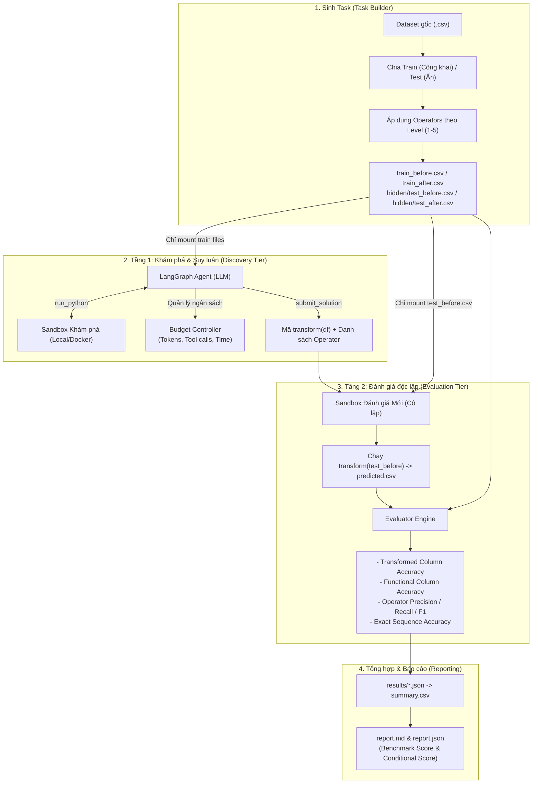

# Kiến trúc Tabular Transformation Discovery Harness

Tài liệu này mô tả chi tiết và ngắn gọn về toàn bộ cấu trúc hệ thống, quy trình thực thi, cơ chế biến đổi và hệ thống đánh giá của Harness.

---

## 1. Sơ đồ luồng tổng quan (Workflow Architecture)



---

## 2. Các thành phần cốt lõi

### 2.1. Hệ thống Phép biến đổi (`transformation/`)
Gồm 19 toán tử kế thừa từ lớp cơ sở [`Transformation`](../transformation/base.py), tích hợp hàm kiểm tra tính hợp lệ toán học `is_applicable` (chống tràn số, vô cùng, chia cho 0, log số âm):
- **Đơn biến & Phi tuyến:** `Log`, `Log1p`, `Square`, `SquareRoot`, `Cube`, `CubeRoot`, `Exp`, `Inverse`, `Abs`.
- **Chuẩn hóa (Scaling):** `StandardScaler` (Z-Score), `MinMaxScaler`.
- **Lượng giác & Kích hoạt:** `Sin`, `Cos`, `Tanh`, `Sigmoid`.
- **Tương tác phụ thuộc đa cột (Inter-column):** `AddInteraction` ($A + B$), `SubtractInteraction` ($A - B$), `MultiplyInteraction` ($A \times B$), `DivideInteraction` ($A / B$).

### 2.2. Bộ sinh Task theo cấp độ khó (`src/benchmark/task_builder.py`)
- **Level 1:** 2 phép biến đổi độc lập trên 2 cột riêng biệt.
- **Level 2:** 3 phép biến đổi độc lập / có chuỗi lồng nhau (Chained: e.g. $\text{Log} \to \text{StandardScaler}$).
- **Level 3:** 4 phép biến đổi độc lập + 1 tương tác phụ thuộc đa cột ($C = A \text{ op } B$).
- **Level 4:** 5 phép biến đổi độc lập + 2 tương tác phụ thuộc đa cột.
- **Level 5:** 6 phép biến đổi độc lập + 3 tương tác phụ thuộc đa cột.

### 2.3. Môi trường Sandbox (`src/sandbox/`)
- **Nguyên tắc an toàn:** Không truyền API Key / Environment variables của host vào sandbox; làm sạch biến môi trường.
- **`LocalProcessSandbox`:** Thực thi code qua subprocess độc lập, áp timeout và giới hạn độ dài stdout/stderr.
- **`DockerSandbox`:** Khởi tạo container riêng biệt cho mỗi lượt chạy, cách ly network (`none`), giới hạn CPU (1 core) và RAM (1GB).

### 2.4. Quản trị Ngân sách (`src/agent/budget.py`)
Áp hard-budget tại controller nhằm đảm bảo tính công bằng và giới hạn tài nguyên:
- `max_total_tokens`: Ngân sách token tích lũy tối đa trong 1 task.
- `max_tool_calls`: Số lần gọi tool `run_python` tối đa.
- `max_wall_time_seconds`: Thời gian tối đa cho 1 episode.
- `max_total_execution_seconds` / `max_total_cpu_seconds`: Thời gian chạy code tối đa trong sandbox.

### 2.5. Hệ thống Đánh giá & Metric (`src/evaluator/`)
Đánh giá song song 2 khía cạnh:
1. **Black-box Functional Correctness (Chấm trên Test Set ẩn):**
   - **`Benchmark Transformed Accuracy` (Metric chính):** Độ chính xác trên tập các cột **thực sự bị biến đổi** (các task timeout/quá budget bị phạt điểm `0.0`).
   - **`Functional Column Accuracy`:** Độ chính xác trên toàn bộ cột của bảng.
2. **White-box Symbolic Recovery (Chấm trên biểu thức Operator):**
   - **`Operator F1-Score`:** Đo độ chính xác của tập toán tử suy luận so với ground truth (hỗ trợ alias normalization như `np.log` $\to$ `LogTransformation`).
   - **`Exact Sequence Accuracy`:** Khôi phục chính xác 100% thứ tự chuỗi phép toán.
3. **Báo cáo phân tầng:**
   - **`Benchmark Scores (All Tasks)`:** Điểm tổng kết toàn Suite (task fail = 0 điểm).
   - **`Conditional Metrics (Submitted Only)`:** Điểm khảo sát chất lượng khi mô hình nộp bài thành công.
   - **`Submission Rate`:** Tỉ lệ hoàn thành task trong ngân sách.

---

## 3. Cấu trúc Thư mục Kết quả Pipeline (`pipeline_runs/<timestamp>/`)

Mỗi lượt chạy sinh ra một thư mục cô lập gồm:
```text
pipeline_runs/<timestamp>/
├── manifest.json       # Metadata tái lập thí nghiệm (seed, dataset, model, config)
├── tasks/              # Các task đã sinh (train_before, train_after, hidden/test_*)
├── logs/               # Log chi tiết JSONL từng lượt gọi LLM, mã python và stdout
├── artifacts/          # Script transform(df) độc lập được agent nộp
├── results/            # Kết quả JSON chi tiết từng task
└── reports/
    ├── summary.csv     # Bảng tổng hợp phẳng toàn bộ các run
    ├── report.json     # Báo cáo dạng JSON cho máy đọc
    └── report.md       # Báo cáo Markdown trực quan (Benchmark & Conditional scores)
```
